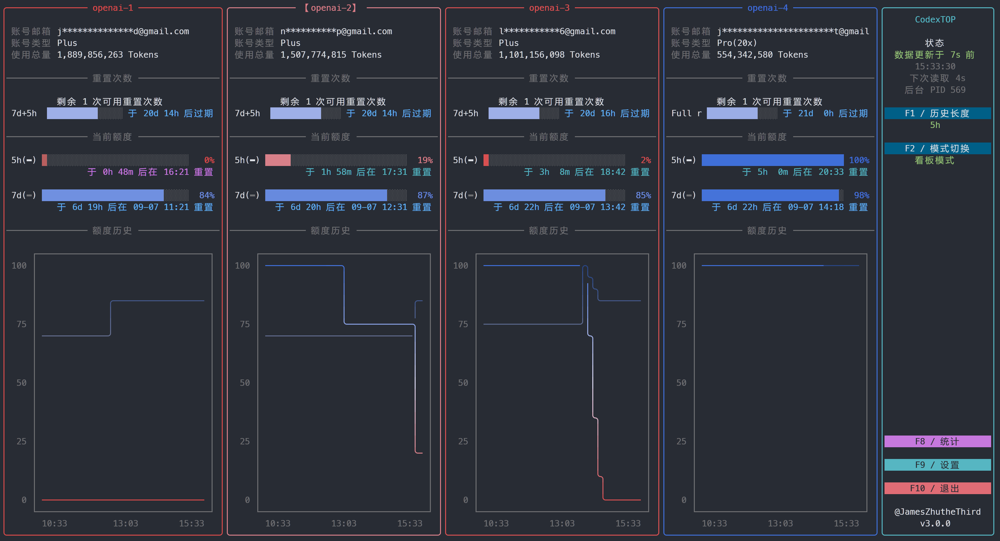
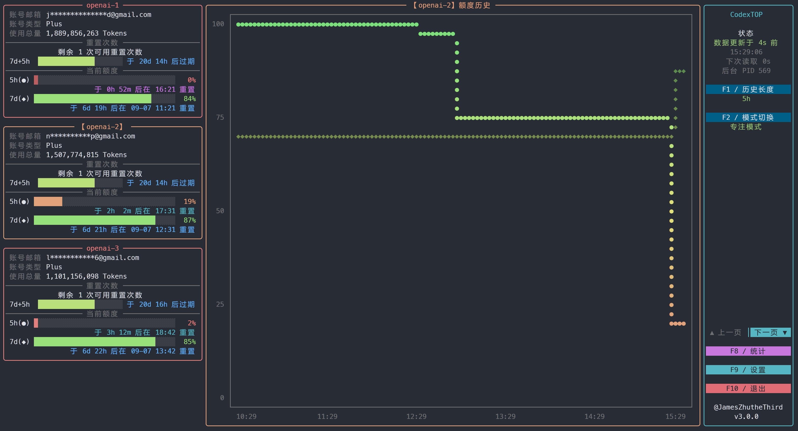
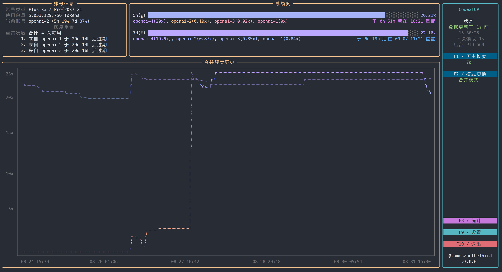
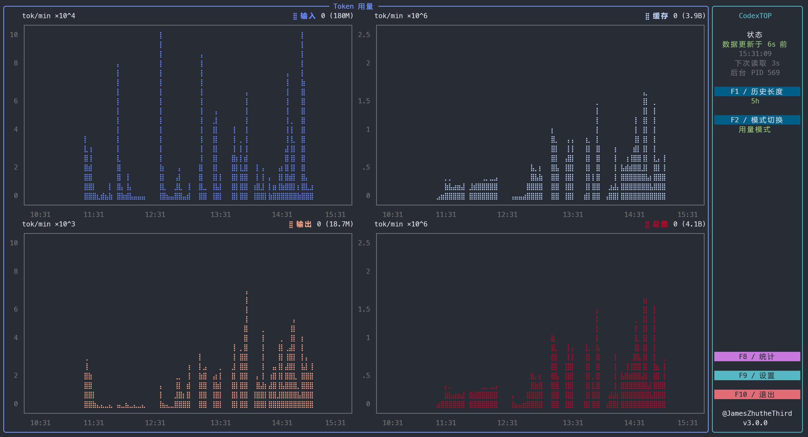
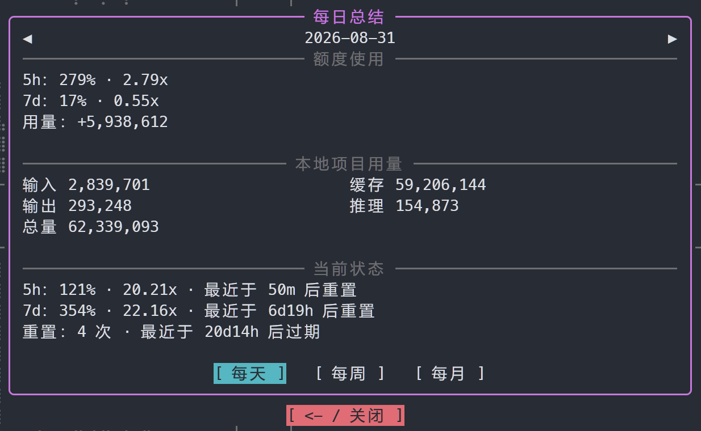
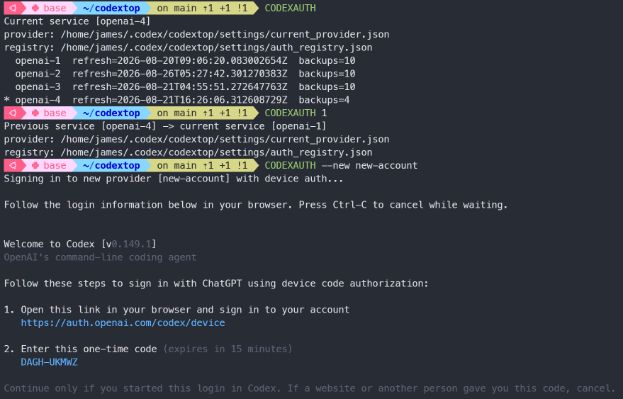
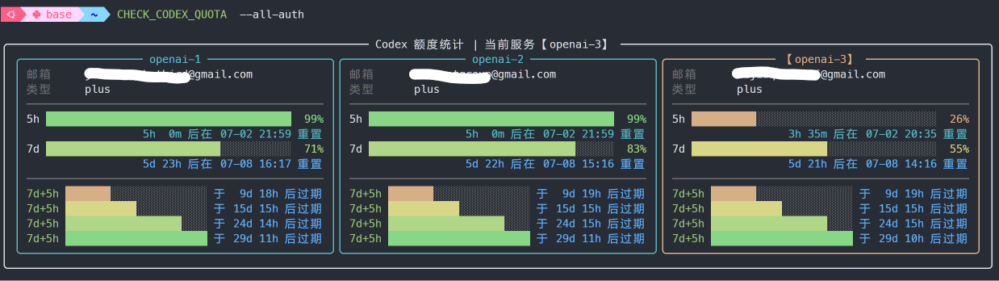

<div align="center">
<p><a href="./README.md">简体中文</a> | <strong>English</strong></p>
<table>
<tr>
<td>
<pre>
   ██████╗ ██████╗ ██████╗ ███████╗██╗  ██╗████████╗ ██████╗ ██████╗  
  ██╔════╝██╔═══██╗██╔══██╗██╔════╝╚██╗██╔╝╚══██╔══╝██╔═══██╗██╔══██╗ 
  ██║     ██║   ██║██║  ██║█████╗   ╚███╔╝    ██║   ██║   ██║██████╔╝ 
  ██║     ██║   ██║██║  ██║██╔══╝   ██╔██╗    ██║   ██║   ██║██╔═══╝  
  ╚██████╗╚██████╔╝██████╔╝███████╗██╔╝ ██╗   ██║   ╚██████╔╝██║      
   ╚═════╝ ╚═════╝ ╚═════╝ ╚══════╝╚═╝  ╚═╝   ╚═╝    ╚═════╝ ╚═╝      
</pre>
</td>
</tr>
</table>

<strong>CodexTOP: a local multi-account Codex quota monitor and manager</strong>

A clickable, interactive terminal interface built with Rich.
</div>

<div align="center">
  
  <p>Focus mode</p>
  
  <p>Dashboard mode</p>
  
  <p>Combined mode</p>
  
  <p>Usage mode</p>
  
  <p>Statistics</p>
  
  <p>Account manage</p>
  
  <p>One-time command-line query</p>
</div>

## Features

| Status | Feature | Description |
|---|---|---|
| ✅ Available | Interactive color terminal UI | Dashboard, focus, combined, and usage modes with separate quota and Token charts |
| ✅ Available | Command-line quota query | `CHECK_CODEX_QUOTA` shows account quotas and the daily-cached online usage total |
| ✅ Available | Background sampler | Queries and caches quota usage and reset credits independently, then writes local JSONL logs |
| ✅ Available | Multi-account switching | `CODEXAUTH` manages `auth-openai-*` accounts and switches providers |
| ✅ Available | Updates | Detects new versions only from GitHub Releases and fast-forwards automatically |
| ✅ Available | Token usage statistics | Incrementally reads root-thread logs from trusted directories; supports four series, stacked bars, and fine bars |
| ✅ Available | Period summaries | Shows yesterday's summary on the first daily launch; the sidebar opens daily, weekly, and monthly quota and Token statistics |
| ✅ Available | New account registration | Adds and initializes new accounts through Codex device authentication |
| ⏩ Planned | Quota reset notifications | Sends a system notification when quota becomes available again |

## Installation

### Option A: Let Codex install it automatically (recommended)

Send either installation-guide link below directly to Codex. It will select a user-level install directory, check dependencies, back up any existing installation, install and verify CodexTOP, and print usage instructions in the terminal.

- GitHub: <https://github.com/JamesZhutheThird/codextop/blob/main/AI_AGENT_INSTALL.md>
- Raw Markdown: <https://raw.githubusercontent.com/JamesZhutheThird/codextop/main/AI_AGENT_INSTALL.md>

You can send this prompt as-is:

```text
Install CodexTOP by following this guide:
https://github.com/JamesZhutheThird/codextop/blob/main/AI_AGENT_INSTALL.md
```

On Linux or WSL with zsh and a working Codex CLI installation, you do not need to choose an install directory, edit shell configuration, or prepare account files manually. An existing `~/.codex/auth.json` is imported on first use. The installer never overwrites an existing source directory or `.zshrc` without creating a backup.

### Option B: Install manually

Clone the repository and run the installer from its root:

```bash
git clone https://github.com/JamesZhutheThird/codextop.git
cd codextop
python3 -m pip install --user 'rich>=13.0.0'
./scripts/install_zshrc.sh
source ~/.zshrc
rehash
```

The following commands are then available:

```bash
CODEXTOP                # Open the CodexTOP interface
CHECK_CODEX_QUOTA       # Query the current account once
CODEXAUTH               # Show or switch the current account
CODEXTOP_UPDATE         # Check GitHub and fast-forward to an available update
```

## Configuration

### Language

On first launch, CodexTOP checks `CODEXTOP_LANG` first. If it is unset, it checks the system's `LC_ALL`, `LC_MESSAGES`, `LANGUAGE`, and `LANG` values in that order. CodexTOP currently includes `en` and `zh_CN`; unsupported or unrecognized locales fall back to English.

Override the initial language before the first run:

```bash
export CODEXTOP_LANG=zh_CN  # Simplified Chinese
export CODEXTOP_LANG=en     # English
```

Press `F9` in the main interface and open **Language** to switch between Simplified Chinese and English. The selection is saved in `codextop_state.json`, takes precedence over automatic environment detection, and takes effect immediately without reloading history. A WSL locale of `C.UTF-8` contains no recognizable language code, so the first launch falls back to English; selecting Simplified Chinese once makes that choice persistent.

Derived history and Token indexes are cached under `~/.codex/codextop/cache/`; monthly JSONL files and Codex session logs remain authoritative. CodexTOP discards and rebuilds a cache automatically when its source files differ, its format is incompatible, or its contents are damaged.

Translation files live in `src/core/locales/`, with one JSON file per language. To add a language, copy `en.json`, preserve the same keys, translate the values, and use the new filename as the `CODEXTOP_LANG` code.

### Runtime paths

CodexTOP uses the standard Codex directory by default:

```bash
~/.codex
```

To use a different directory:

```bash
export CODEXTOP_CODEX_DIR=/path/to/.codex
```

Account files are stored here:

```bash
~/.codex/codextop/auth_list/auth-openai-1.json
~/.codex/codextop/auth_list/auth-openai-2.json
~/.codex/codextop/auth_list/auth-openai-3.json
```

The filename format is `auth-{keyword}.json`; for example, the keyword in `auth-openai-1.json` is `openai-1`.

During installation or first use, CodexTOP copies `~/.codex/auth.json` to `auth-openai-1.json` if the auth list is empty.

Runtime data is written to:

```bash
~/.codex/codextop/auth_list/backup/
~/.codex/codextop/log/
~/.codex/codextop/log/quota_snapshots_YYYY-MM.jsonl
~/.codex/codextop/settings/current_provider.json
~/.codex/codextop/settings/auth_registry.json
~/.codex/codextop/settings/token_usage_daily.json
```

Synchronize the configuration once with:

```bash
CODEXAUTH sync
```

## Usage

Open the main interface:

```bash
CODEXTOP
```

### Account switching

Show the current provider and account list:

```bash
CODEXAUTH list
```

Add a provider through Codex device authentication:

```bash
CODEXAUTH --new 4                 # Add and switch to openai-4
CODEXAUTH --new name_of_provider  # Use a custom provider name
CODEXAUTH --new my-api --api      # Interactively import and switch to an API source
```

Without `--api`, `--new` starts and manages a `codex login --device-auth` subprocess. The login URL, device code, and progress are streamed unchanged to the current terminal, with a blank line separating CodexTOP messages from the Codex login output. Press `Ctrl-C` to cancel while waiting.

After you complete the browser flow, CodexTOP checks `codex login status`, account information, and quota status. Only after every check passes does it save `auth-{provider}.json`, switch to the new provider, update the auth registry, and request an immediate background refresh. A numeric target such as `4` is normalized to `openai-4`.

Refresh an existing provider manually (the current provider is the default):

```bash
CODEXAUTH --refresh
CODEXAUTH --refresh openai-2
```

Refresh also runs device authentication in a temporary directory. CodexTOP backs up and replaces the saved auth only when the new auth passes login and online quota validation and the token email, online email, and original provider email all match. If any condition cannot be verified, neither the registered provider nor the active `auth.json` is overwritten.

Delete a registered provider (the current provider is the default):

```bash
CODEXAUTH --delete            # Delete the current provider
CODEXAUTH --delete openai-2
```

Before deletion, you must type the complete, exact provider ID again, such as `openai-2`. After confirmation, CodexTOP removes the provider auth file and its credential backups. If it was current, another registered provider becomes current; if none remain, the active `auth.json` is removed. Existing quota history is retained.

Rename a saved account or API source:

```bash
CODEXAUTH --rename openai-2 work
CODEXAUTH --rename my-api proxy
```

Renaming updates the auth file, backup directory, and current provider marker. Existing quota history keeps its original name.

`CODEXAUTH --new my-api --api` opens a borderless terminal form matching ordinary `--new`. Choose hidden manual API Key input or enter an environment variable name in PATH (e.g. `OPENAI_API_KEY`, exported in the current terminal). The variable is checked for a nonempty value and the key is shown masked (e.g. `sk-a******z`). Each switch to that source rereads the environment variable. Leave Base URL blank for `https://api.openai.com/v1`, or enter a third-party Responses-compatible endpoint.

Import switches to the new source immediately; use `CODEXAUTH switch my-api` for later switches. Credential files use `0600` permissions, and keys are excluded from list and JSON summaries. Import validates local configuration and key format without an online request. API sources do not expose ChatGPT subscription quotas or use the `--refresh` device login flow.

Switch providers with:

```bash
CODEXAUTH switch 1
CODEXAUTH switch 2
CODEXAUTH switch 3
CODEXAUTH switch openai-1
CODEXAUTH switch my-api
CODEXAUTH 5                       # API account number
```

For a numeric target, CodexTOP looks for `auth-1.json` first and then `auth-openai-1.json`. If the target does not exist, the error includes the matching `CODEXAUTH --new ...` command.

API accounts are numbered after existing numeric accounts. Run `CODEXAUTH list` to see the numbers and `CODEXAUTH 5` to switch. API sources store configuration and credentials only in the `meta` fields of `auth_registry.json`, without separate API account files; switching writes the active API configuration to `[model_providers.codexauth-third-party-api]` at the end of `config.toml` and removes other CODEXAUTH-managed API provider blocks. Switching back to ChatGPT removes those API blocks while retaining account data.

CodexTOP refuses to add, rename, refresh, delete, or switch providers while a Codex process whose command name starts with `codex` is running.

### Command-line queries

Query quota information with:

```bash
CHECK_CODEX_QUOTA             # Show the current account
CHECK_CODEX_QUOTA --all-auth  # Show every account
```

### Updates

Check for and synchronize CodexTOP updates:

```bash
CODEXTOP_UPDATE               # Fast-forward when an update is available
CODEXTOP_UPDATE --check-only  # Check without updating
```

The first time you open `CODEXTOP` each day, it reads the GitHub latest release in the background. Only a Release version newer than the installed version produces a yellow button at the very bottom of the sidebar, after the author, current version, and one blank row:

```text
@JamesZhutheThird
v3.1.1

F11 / New version
```

Click the button or press `F11` to open the GitHub Release notes overlay. Use the arrow keys to scroll, `Backspace` to close it, or `Enter` to confirm the update. After confirmation, CodexTOP leaves the full-screen interface and runs the updater with its command output visible. Reopen `CODEXTOP` after the update completes.

The updater uses the current repository's `origin` and current branch by default. Override either value with:

```bash
export CODEXTOP_UPDATE_REMOTE=origin
export CODEXTOP_UPDATE_BRANCH=main
```

Automatic updates accept only GitHub remotes and use fast-forward updates only. CodexTOP refuses to update automatically when the working tree has uncommitted changes or the remote update cannot be fast-forwarded.

### Color scheme files

Built-in color schemes live in `src/ui/styles/`, one file per scheme. The filename is the scheme key, for example:

```text
src/ui/styles/classic.json
src/ui/styles/icefire.json
src/ui/styles/bright.json
```

Built-in display names come from the language translation files. Point `CODEXTOP_COLOR_SCHEME_DIR` to another directory to load custom schemes, which may include an optional `label`. The `percent` map can contain every value from `0` through `100` or only selected stops; missing values are linearly interpolated between adjacent stops.

```json
{
  "label": "Classic custom",
  "percent": {
    "0": "#e07b7b",
    "50": "#e0e07b",
    "100": "#7be07b"
  }
}
```

### Background sampler

The installer starts the background sampler automatically. Start or stop it manually with:

```bash
./scripts/start_codextop_backend.sh
./scripts/stop_codextop_backend.sh
```

The quota-usage endpoint follows the sidebar's update interval. A separate background task refreshes reset credits every 60 seconds by default and caches them per account. A reset-credit query failure does not discard quota usage collected at the same time or trigger an immediate retry on the next usage sample. After a 5h/7d query receives HTTP 429, CodexTOP uses the most recent successful result for the configured fallback interval. Reset credits retain their last successful result indefinitely and show zero only after a successful query explicitly returns zero.

Configure both intervals in `pyproject.toml`, then restart the sampler and CodexTOP:

```toml
[tool.codextop]
reset_credits_interval_seconds = 60
http_429_fallback_seconds = 600
week_start = "monday"
```

Weekly summaries start on Monday by default. Set `week_start` to any English weekday name from `tuesday` through `sunday` to change it.

The account statistics endpoint supplies each account's total usage, which is cached per account for 24 hours. Failed queries wait until the next period to prevent a refresh storm. On first use, CodexTOP reads trusted projects from `~/.codex/config.toml` and synchronizes them to `~/.codex/codextop/settings/token_usage_directories.json`. Set a directory's `disable` value to `true` to exclude it. Usage scope can include only the current trusted directory or every enabled trusted directory.

Usage mode aggregates local `token_count` events from root threads in the selected directories. It compares log modification times and sizes, reads only appended data, and checks active logs about every 200 milliseconds. The current rate becomes zero when no new events arrive. Input, cached-input, output, and total rates are lightly smoothed and drawn as four fixed-color series; the legend shows each current rate and its cumulative total in parentheses.

The usage layout can combine or split the series. Split mode adapts to the available drawing area with a 1×4, 2×2, or 4×1 layout and scales each subplot independently. With enough height it shows all six vertical-axis ticks; in limited space it shows only zero and the maximum, without blank rows between vertical subplots. Combined bar and fine-bar modes stack the first three series; fine bars use 2×4 subcharacters. Every non-bar mode draws the four series independently.

The combined chart selects one of three six-tick vertical scales according to the data range: `0/.5/1/1.5/2/2.5`, `0/1/2/3/4/5`, or `0/2/4/6/8/10`. It uses `tok/h` when each plotted column spans strictly more than 15 minutes and `tok/min` otherwise. Other display modes do not scan session logs and retain the original quota charts and axes. Existing Token fields in older JSONL files remain compatible and require no migration.

## License

This project is licensed under `CC BY-NC-SA 4.0`.
